<div align="center">

```
 ███████╗███████╗ ██████╗ ██████╗ ███╗   ██╗██████╗
 ██╔════╝██╔════╝██╔════╝██╔═══██╗████╗  ██║██╔══██╗
 ███████╗█████╗  ██║     ██║   ██║██╔██╗ ██║██║  ██║
 ╚════██║██╔══╝  ██║     ██║   ██║██║╚██╗██║██║  ██║
 ███████║███████╗╚██████╗╚██████╔╝██║ ╚████║██████╔╝
 ╚══════╝╚══════╝ ╚═════╝ ╚═════╝ ╚═╝  ╚═══╝╚═════╝
 ██████╗ ███████╗ █████╗ ██╗     ██╗████████╗██╗   ██╗
 ██╔══██╗██╔════╝██╔══██╗██║     ██║╚══██╔══╝╚██╗ ██╔╝
 ██████╔╝█████╗  ███████║██║     ██║   ██║    ╚████╔╝
 ██╔══██╗██╔══╝  ██╔══██║██║     ██║   ██║     ╚██╔╝
 ██║  ██║███████╗██║  ██║███████╗██║   ██║      ██║
 ╚═╝  ╚═╝╚══════╝╚═╝  ╚═╝╚══════╝╚═╝   ╚═╝      ╚═╝
          · · ·  for the original Xbox  · · ·
```

### Future Crew's legendary 1993 PC demo, running natively on the original Xbox


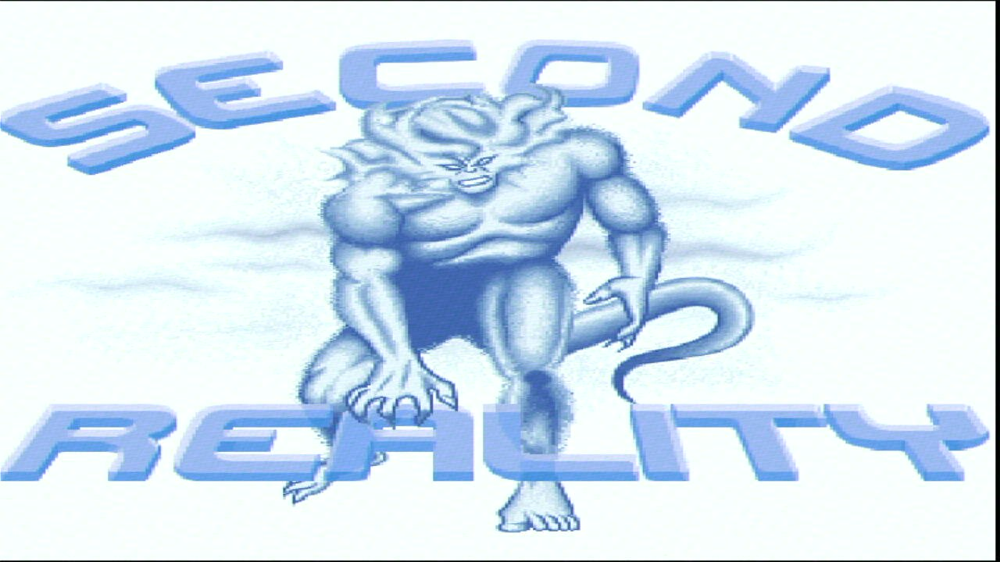

<sub>The title picture, captured from a real original Xbox</sub>

</div>

---

> *"This demonstration has been designed for fast machines, which in this case means
> 33 MHz 486 computers."*
> &nbsp;&nbsp;&nbsp;&nbsp;&nbsp;&nbsp;— the Second Reality start-up menu, 7 October 1993

Thirty-odd years ago, a group of Finnish teenagers calling themselves **Future Crew** squeezed
real-time 3D, plasma, tunnels, raytraced water and a full-blown orchestral tracker soundtrack
out of a VGA card and a Gravis Ultrasound. **Second Reality** won the PC demo competition at
**Assembly '93**, was copied from BBS to BBS around the world, and turned a generation of kids
into programmers, musicians and pixel artists.

Now it boots on Microsoft's **original Xbox**: every part, every effect, every note of
Purple Motion's and Skaven's soundtrack. It runs on a real console and in [xemu](https://xemu.app).

As far as we know, this is the first native port of Second Reality to the original Xbox.

## 🤖 Ported by Claude Code, in one afternoon

This whole port was written by **[Claude Code](https://claude.com/claude-code)**, Anthropic's
AI coding agent, in **a single afternoon**: about **four hours**, from an empty folder to the
full demo running on a real original Xbox. It ran on the console after about three hours.

Nothing was hand-written. The starting point was the original 1993 DOS sources, which are
mostly 386 assembly, and the goal was "port this to the OG Xbox". Along the way Claude Code:

* wrote a register-level VGA emulator and an S3M tracker player from scratch, and ported all
  the parts from C and assembly to C++, original quirks included
* pulled the demo's data straight out of the 1993 OMF object files
* unpacked the PKLITE-compressed release executables in a CPU emulator and disassembled them,
  to find where the shipped demo differs from the published source
* compared the port frame by frame against a video of the original
* debugged the real console over a serial cable, together with a second Claude Code session
  working on the console's kernel: an audio-interrupt hang, a black start menu caused by
  thread scheduling, tearing, and missed vblanks

The human's job was to point it at the problem, watch the result on a real TV next to the
original, and say what looked or sounded wrong.

The toolchain and the platform are open source too:

* **[nxdk](https://github.com/XboxDev/nxdk)**, the open-source original Xbox development kit,
  with its SDL2 port
* **OXOS**, an open-source original Xbox kernel. The port was developed and tested on a
  real v1.4 console running OXOS, and in xemu.

No Microsoft XDK, no Microsoft kernel, and no Microsoft libraries were used.

## 📸 Screenshots

Every picture here was captured from a **real original Xbox** (v1.4, component video)
running this port.

<div align="center">
<table>
<tr>
<td align="center">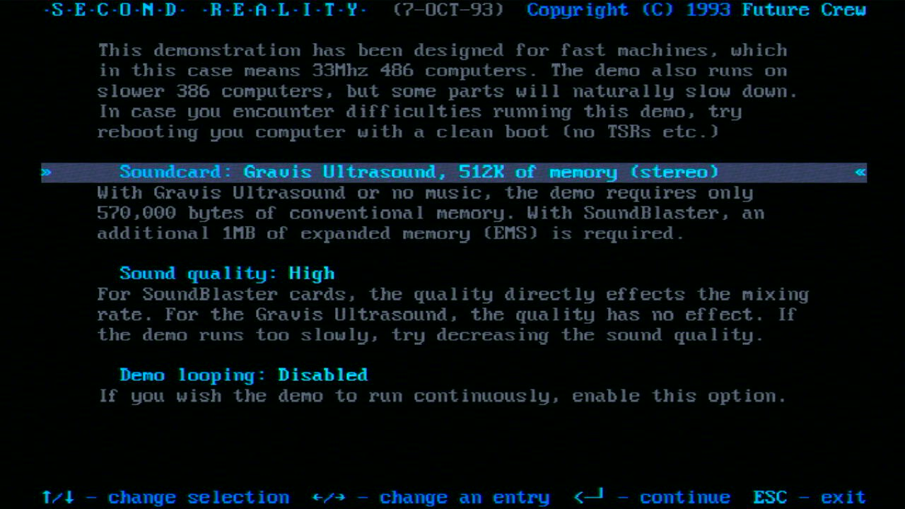<br><sub>The 1993 start menu, still asking for a 486</sub></td>
<td align="center">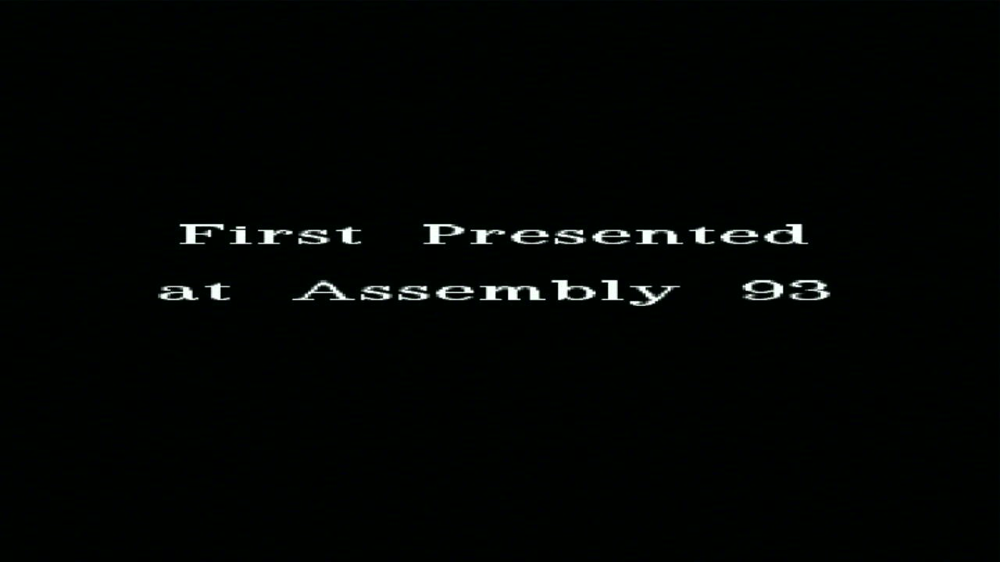<br><sub>First Presented at Assembly 93</sub></td>
<td align="center">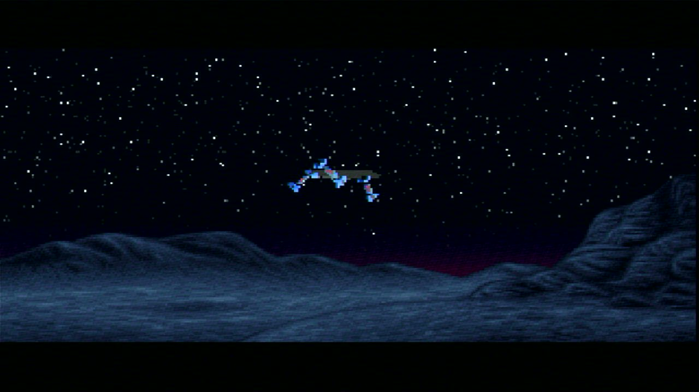<br><sub>U2A: flying over the mountains</sub></td>
</tr>
<tr>
<td align="center">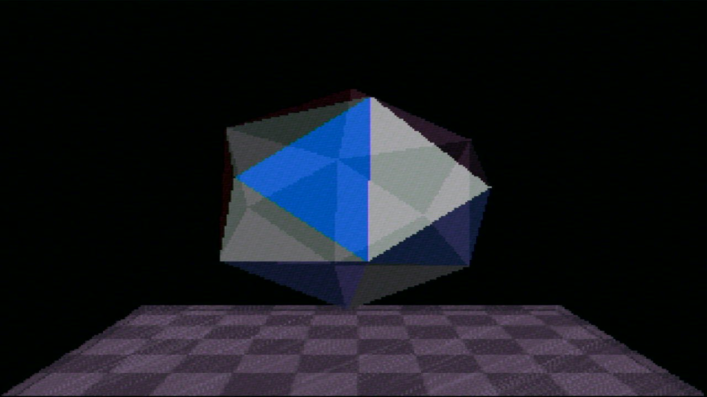<br><sub>GLENZ: see-through vector bodies</sub></td>
<td align="center">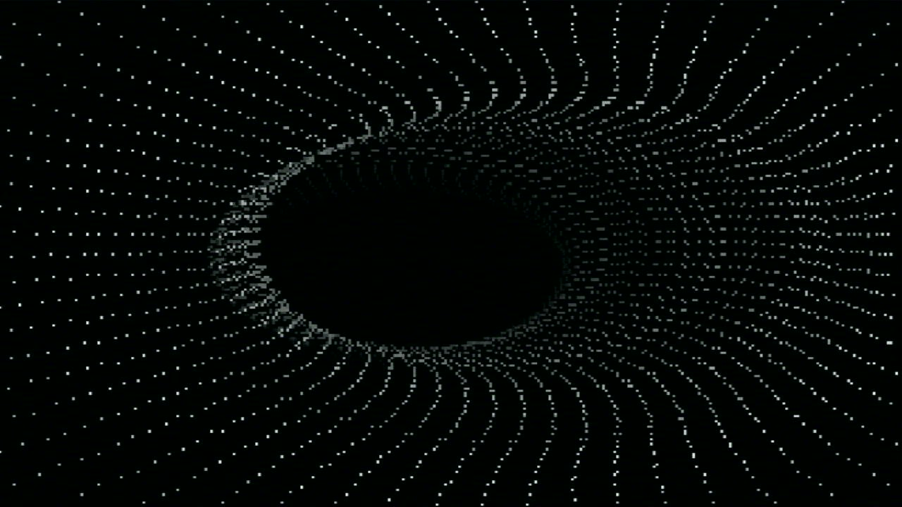<br><sub>TUNNELI: the dot tunnel</sub></td>
<td align="center">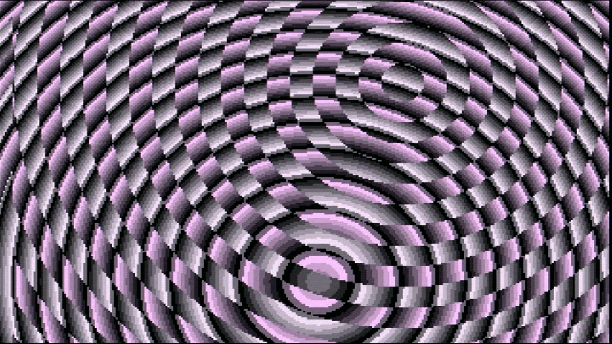<br><sub>TECHNO: interference circles</sub></td>
</tr>
<tr>
<td align="center">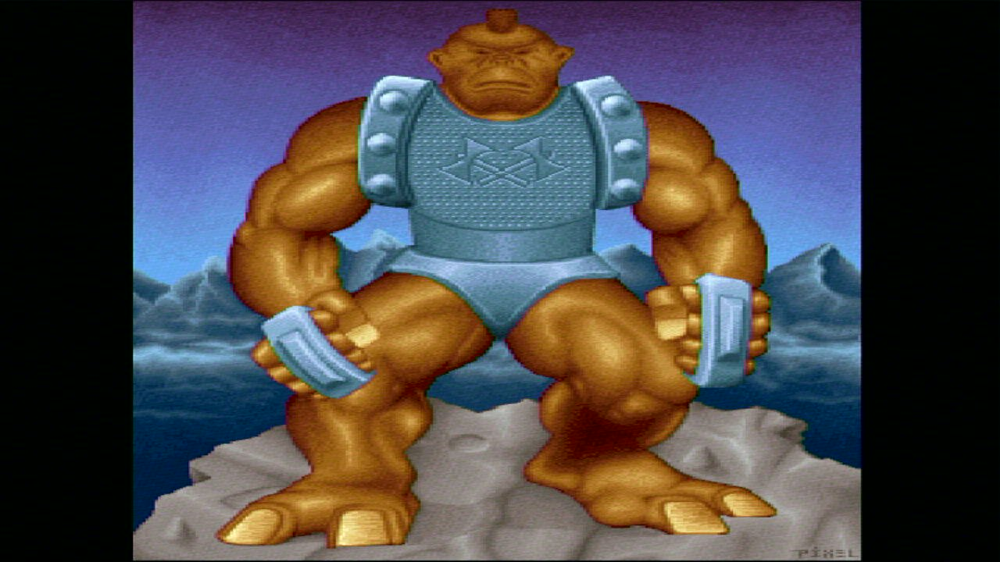<br><sub>The troll</sub></td>
<td align="center">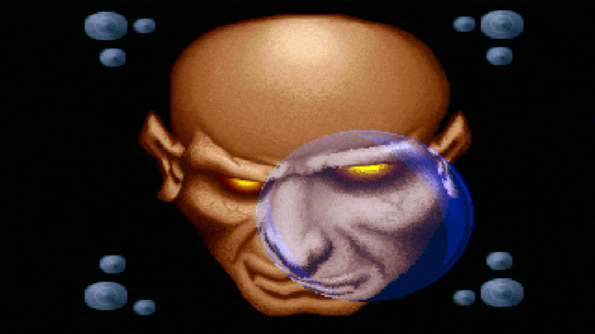<br><sub>LNS&ZOOM: the lens</sub></td>
<td align="center">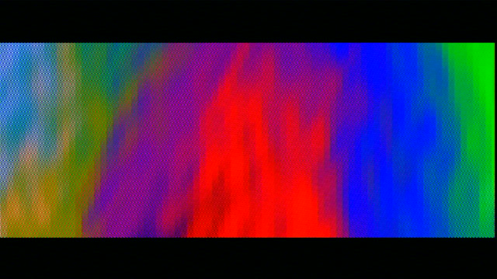<br><sub>PLZPART: plasma</sub></td>
</tr>
<tr>
<td align="center">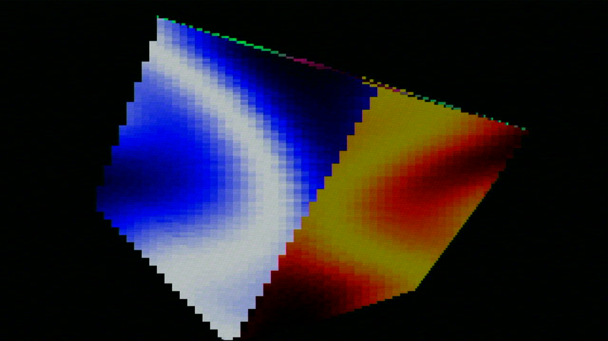<br><sub>The plasma cube</sub></td>
<td align="center">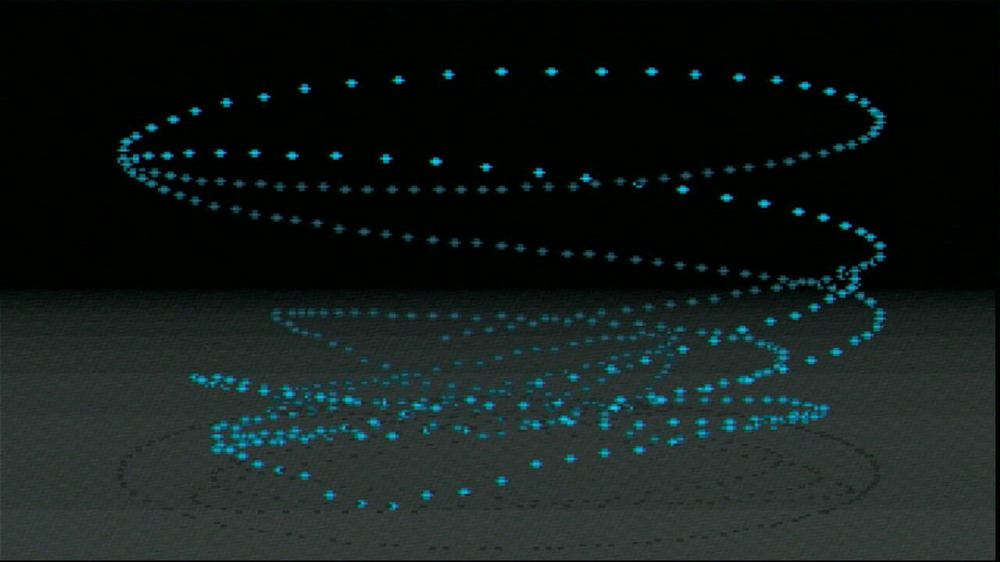<br><sub>MINVBALL: dancing dots</sub></td>
<td align="center">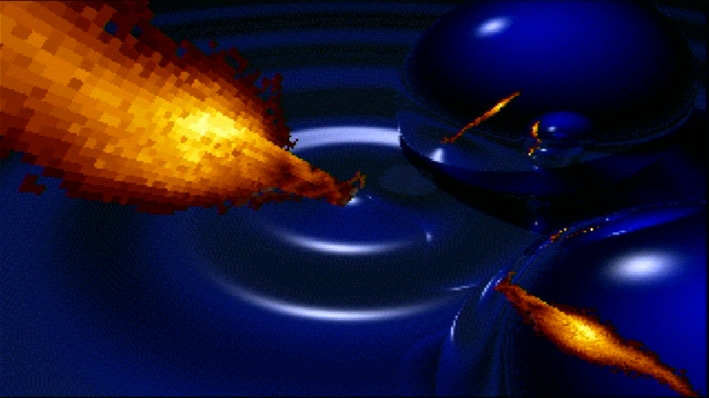<br><sub>RAYSCRL: raytraced water</sub></td>
</tr>
<tr>
<td align="center">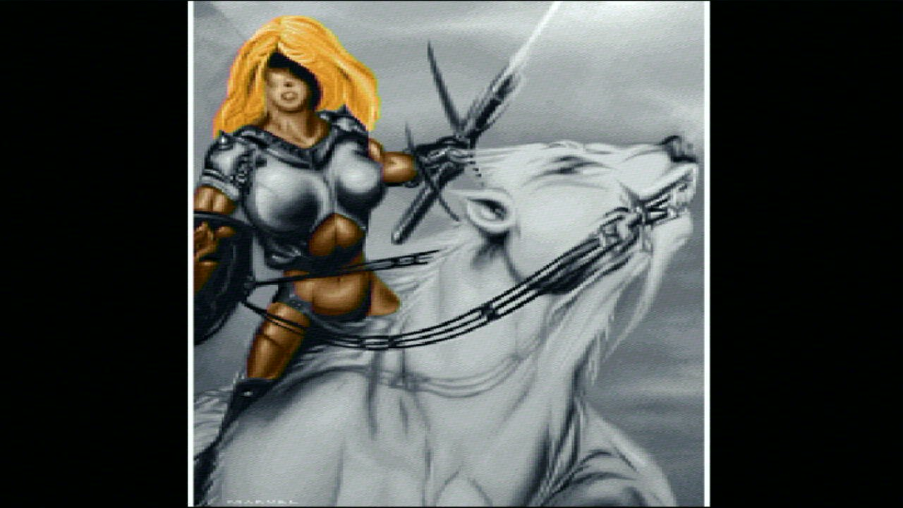<br><sub>JPLOGO: the wobbling picture</sub></td>
<td align="center">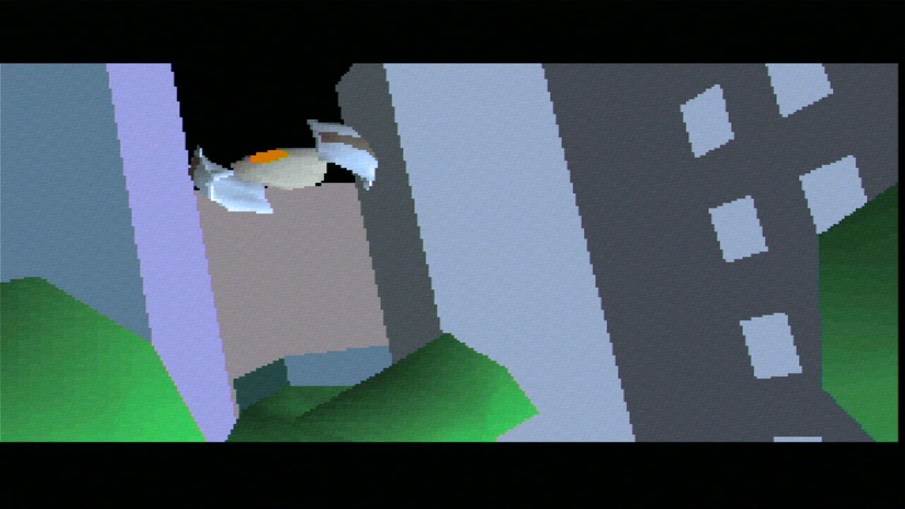<br><sub>U2E: the city flight</sub></td>
<td align="center">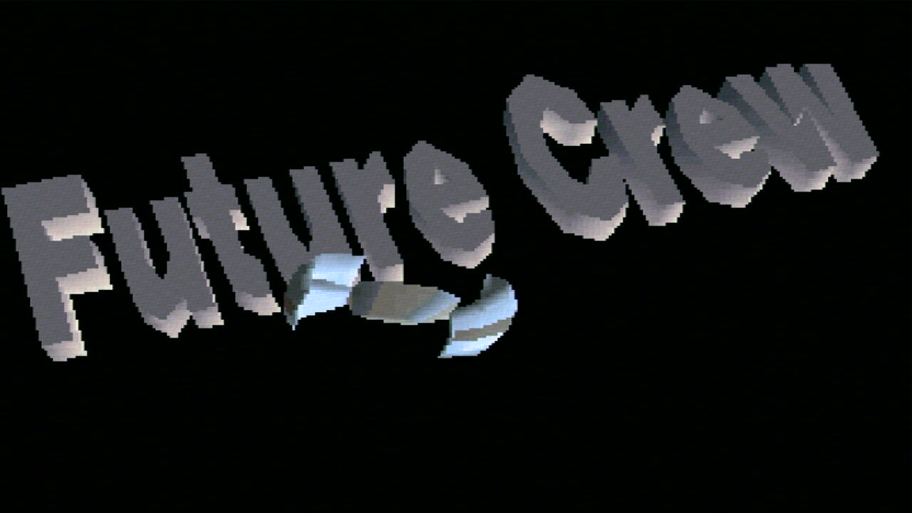<br><sub>Future Crew, in chrome</sub></td>
</tr>
</table>
</div>

## 🎬 What's in it

The whole demo, about sixteen minutes including the end scroller, synced to the music
exactly like the original:

| ⏱ | Part | What you see |
|---|---|---|
| 0:00 | `ALKU` | "A Future Crew Production" over the scrolling mountain landscape |
| 1:20 | `U2A` | The first vector part: ships flying over the landscape |
| 1:41 | `PAM` | The explosion |
| 1:47 | `BEGLOGO` | The *Second Reality* title picture fading in from white |
| 1:49 | `GLENZ` | Translucent "glenz" vector objects bouncing on a checkerboard |
| 2:33 | `TUNNELI` | The dot tunnel |
| 2:48 | `TECHNO` | Interference circles and moiré bars, then the troll |
| 3:45 | `PANICEND` | The TV switches off… |
| 3:51 | `MNTSCRL` | The forest scroller |
| 4:20 | `LNS&ZOOM` | The lens and the rotozoomer |
| 5:06 | `PLZPART` | Plasma, then the plasma-textured cube |
| 6:13 | `MINVBALL` | Dancing dots |
| 6:50 | `RAYSCRL` | The raytraced water and chrome balls |
| 7:19 | `3DSINFLD` | The 3D sine-field landscape |
| 7:48 | `JPLOGO` | The wobbling picture |
| 8:00 | `U2E` | The city flight |
| 8:55 | `ENDLOGO` · `CRED` · `ENDSCRL` | The end logo, the credits, and the end scroller |

Plus the hidden part, `DDSTARS`, an experiment Future Crew left out of the final show.

## 🎮 Controls

| Button | Does |
|---|---|
| D-pad | Move around the start menu / change an entry |
| A or Start | Start the demo (and leave the end screen) |
| B | Leave the menu |
| Back | Abort the demo, like ESC on the PC |
| White | Skip to the next part |

The menu options work as they did in 1993. *Soundcard: No sound* mutes the music, though the
demo still syncs to it. *Demo looping* plays it forever and skips the end scroller.
*Sound quality* has no effect, because the port always mixes at 48 kHz.

## 🛠 Building

You need:

* [nxdk](https://github.com/XboxDev/nxdk) with its SDL2 (any recent master)
* clang and lld (nxdk's toolchain), `python3`, `rsync`, `make`
* the original Second Reality source, which is a git submodule here

```sh
git clone --recursive https://github.com/kooscode/SecondReality.git
cd SecondReality
export NXDK_DIR=/path/to/nxdk      # or put NXDK_DIR=... in tools/nxdk-env.local.sh
./build.sh
```

The ISO lands in `build/xbox/SecondReality.iso`. Load it in xemu or burn it, or put it on a
real console's disk and start it with an ISO launcher.

No demo data lives in this repository. `tools/mkdata.py` pulls everything (music, pictures,
3D scenes, fonts) out of the original source tree at build time. Some of it comes straight
from the 1993 object files, using a small OMF reader in `tools/omf.py`.

### PC test build

There's also a headless Linux build, used to check the port frame by frame against the
original:

```sh
make -f Makefile.host
build/host/s2r_host --keys 0.5:enter --dump /tmp/frames --dump-at 175,180 --wav /tmp/demo.wav
```

It runs on a virtual clock, writes PPM frames and a WAV of the soundtrack, and takes
`--start N` to jump straight to a part group (`--start 8` runs the hidden part).

## 🔬 How it works

Second Reality was never meant to be portable. It's twenty-odd separate DOS executables
written in C and a *lot* of 386 assembly, held together by a loader that plays the music and
fakes a "copper" (the timer interrupt that fires on every VGA retrace). They talk to the
VGA card's registers directly and lean on every quirk it has. So the port doesn't
reimplement the effects. It reproduces the machine they ran on:

* **A register-level VGA emulator.** It covers planar, chained and unchained ("mode X") memory
  with latches and all four write modes; CRTC start addresses, split screens, line compare
  and pixel panning; the attribute controller and its flip-flop; DAC palette writes down to
  the half-written colour; and text mode with the real 8x16 font. Every part writes
  ports and video memory just like it did on DOS.
* **The copper.** The 70 Hz retrace interrupt is a timer thread, with the original's exact
  ordering of the display latch, the copper routines and the frame counter.
* **The DIS loader API.** That's sync points, music position, frame counters and the message
  areas that the parts and the loader use to talk to each other, all re-created from
  `DIS/` and `U2.ASM`.
* **The music player.** A from-scratch S3M player replaces Future Crew's STMIK, with its quirks:
  the encrypted pattern data, ST3.00 volume slides and the tempo patch the loader applies. It
  was checked against libopenmpt with zero drift.
* **Every part was ported line by line** from the C and assembly into C++, original bugs
  included. Where the shipped 1993 executables differ from the published source, the port
  follows the executables, which were unpacked and disassembled to check (the end scroller,
  the plasma timing).

### The Xbox side

* **Video.** 640x480x32, triple-buffered, with flips synced to vertical blank by polling the
  GPU, with no interrupts.
* **Audio.** A polled AC97 driver on a real console. It doesn't use nxdk's XAudio, whose interrupt
  handler can lock up a console after a quick reboot. xemu doesn't route AC97 to the
  speakers, so there the port detects the emulated codec and streams the music through an
  **APU voice** instead, the hardware DirectSound uses.
* **Input** goes through SDL2's game controller API.

Test builds can be configured with `./build.sh EXTRA=...`:
`-DS2R_AUTOSTART` (skips the menu, shows an on-screen timing overlay), `-DS2R_START=N` (starts
from part group N), `-DS2R_DIAG` (start-up diagnostics on the serial port).

### Known differences from the PC original

* The 320x200/320x400 VGA picture is scaled to 640x480. The demo runs at its native 70 Hz,
  but a TV refreshes at 60, so about one frame in seven is never shown.
* `U2A` sets its own video mode on entry. The original relied on leftovers from `ALKU`.
* The hidden `DDSTARS` part can only be reached from the PC test build for now.

## 🙌 Credits

**Second Reality** © 1993 **Future Crew**:

| | |
|---|---|
| 🎨 Graphics | **Marvel**, **Pixel** |
| 🎵 Music | **Purple Motion**, **Skaven** |
| 💻 Code | **Psi**, **Trug**, **Wildfire** |
| ✨ Additional design | **Abyss**, **Gore** |

Future Crew released the full source and data in 2013, for the demo's 20th anniversary, at
[github.com/mtuomi/SecondReality](https://github.com/mtuomi/SecondReality). This port wouldn't
exist without that release. Thank you, Future Crew. 💜

Also thanks to:
* **[nxdk](https://github.com/XboxDev/nxdk)** and the XboxDev community, for a free, open
  toolchain for the original Xbox
* **[xemu](https://xemu.app)**, the original Xbox emulator this was developed against
* **Fabien Sanglard**'s [code review of Second Reality](https://fabiensanglard.net/second_reality/),
  a great tour of the original source

## 📜 License

This port is free and unencumbered software released into the public domain under the
[Unlicense](UNLICENSE), just like the original: Future Crew released Second Reality's source
and data under the same [Unlicense](third_party/SecondReality/UNLICENSE).

`tools/font8x16.bin` is the standard IBM VGA 8x16 text-mode font, used for the start menu
and the end screen.

---

<div align="center">

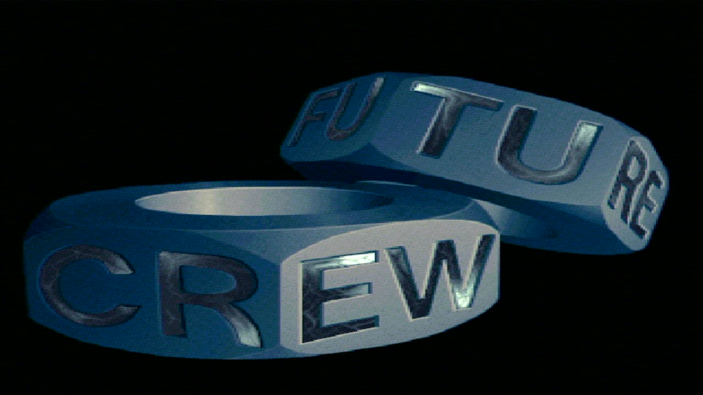

*Greetings to everyone who ever sat in front of a 486 at 3 a.m. waiting for the plasma to
kick in.*

**FC · 1993 → Xbox · 2026**

</div>
