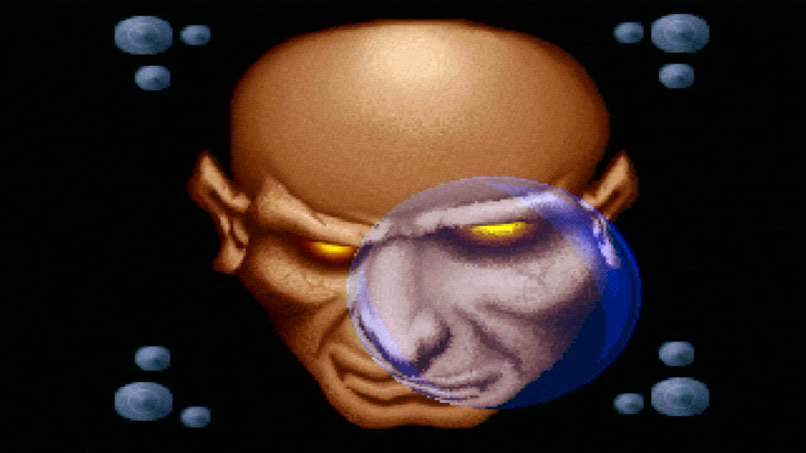
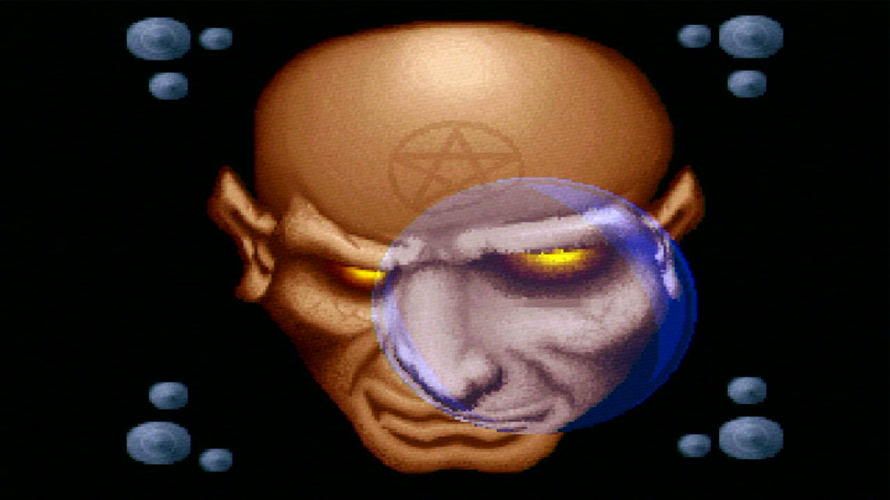

# Second Reality 1993 release: lens picture

`LENS.EXB` is the background picture of the `LNS&ZOOM` part (the face under the lens) as
the original 1993 release shipped it: the face has a pentagram on its forehead. The 2013
source release (`third_party/SecondReality/LENS/LENS.EXB`) has the same picture without it.
Nothing else in the part differs.

<table>
<tr>
<td align="center"> 2013 source</td>
<td align="center"> 1993 release</td>
</tr>
</table>

Same format as the source file: the 16 byte `Uh1` header, a 768 byte palette and 320x200
pixels (64784 bytes). `./build.sh OG1993=1` builds the demo with it.

How it was extracted from `SECOND.EXE` (1,451,093 bytes, dated 7 Oct 1993):

1. The parts are appended to the loader in the U2PACK format (`MAIN/PACK.C` in the source):
   each file is XORed with 0xFF wherever `(file offset * key) & 0xFFFF < 0xF000`, the key
   being a hash of the file name. `LNS&ZOOM.EXE` (key 0x9A0D) is the 67226 bytes at
   0x4AF90; its first two bytes are stored as `EB FA` instead of `MZ`.
2. That EXE is packed twice: PKLITE 1.14 over Microsoft EXEPACK (the lens makefile links
   with `/E`). Both were undone with [deark](https://github.com/jsummers/deark).
3. The picture sits at offset 0x7B20 of the unpacked EXE.

The same steps on the source tree's `MAIN/DATA/LNS&ZOOM.EXE` give back
`LENS/LENS.EXB` byte for byte; the 1993 copy differs from it in 2058 bytes, all inside
x 129-211, y 33-91 (the forehead).
